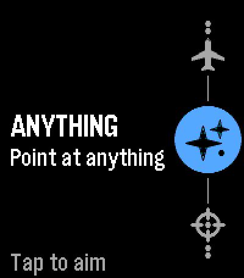
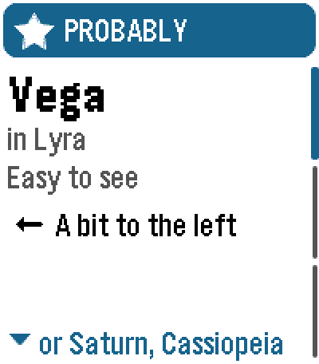
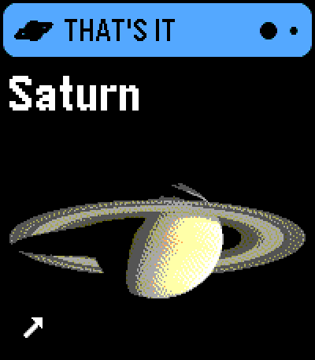
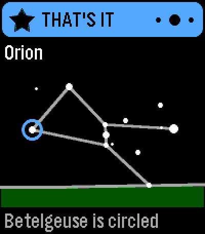
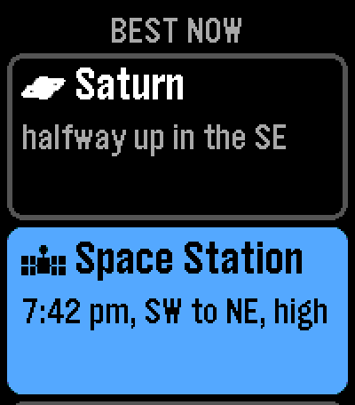
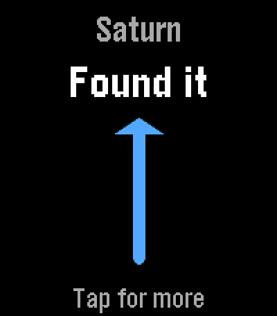
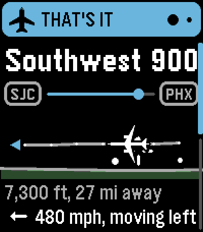
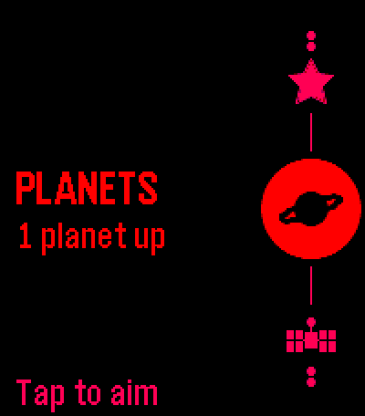

# Pointer Planetarium

Point at something in the sky with your finger, and your Pebble Time 2
tells you what it is.

<p>




</p>
<p>




</p>

Pointer Planetarium knows:

- **The Moon and the planets**, with pictures of each.
- **About 2,900 stars** (everything you can see by eye on a dark night)
  with their names, and all 88 constellations.
- **Satellites you can see**: the International Space Station, China's
  Tiangong station, the Hubble Space Telescope, bright satellites and
  rocket stages, and trains of new Starlink satellites.
- **Planes** flying around you, with their flight number, route and type.

It also works the other way round: pick the Moon, a planet, a
constellation, a bright star or the Space Station, and **Find it** steers
you to it. After a sure answer you get a little star chart, drawn the way
the sky looks right now, and a fun fact.

It's free and open source, with no ads, no accounts and no tracking.

## What you need

- A **Pebble Time 2**. (It's made for the Time 2's color touch screen and
  doesn't run on other Pebbles.)
- The **Pebble app** on your phone, with location allowed for Pointer
  Planetarium. Your phone does the sky math and downloads satellite and
  plane data, so the phone needs to be nearby. Without it, the watch can
  still name the stars, the Moon and the planets.

## Install

1. On your phone, download `pointer-planetarium-v1.0.pbw` from the
   [latest release](../../releases/latest).
2. Open the file with the Pebble app (share it to the Pebble app, or tap
   it in your downloads). The app installs it on your watch.
3. Open **PointerPlanetarium** from your watch's app list.

## Getting started

1. **Which wrist?** The first time, the watch asks which wrist it's on (UP
   for left, DOWN for right).
2. **Where are you?** City, Suburbs or Dark sky. City lights wash out
   faint stars, so this sets what the app expects you to see (about 80,
   260 or 900 stars).
3. **What do you look with?** My eyes, Binoculars or Telescope. Find it
   offers what you can see with it.
4. **Calibrate the compass.** The watch needs a calibrated compass to know
   where you're pointing. Whenever it isn't calibrated, the watch shows a
   figure 8 and won't do anything else until it is: draw a big figure 8 in
   the air with your watch until it says **Compass ready!** It keeps its
   calibration, so you'll only see this now and then. If it takes a while,
   step away from cars and metal. BACK leaves the app.

You can change your wrist, sky and gear later in the watch's menu or on
the phone.

## Pointing at things

1. **Tap the screen (or press SELECT)**, then point at something in the
   sky with your finger, the way you'd show it to a friend. Hold still.
2. When your arm is steady the watch records for a moment and gives a
   light **tick**. You can lower your arm. The screen says **Checking the
   charts** while your phone works it out.
3. **Buzz!** The answer is on the screen. One buzz means it's sure (or
   nearly). Two buzzes mean "maybe", "nothing I know is there", or a
   warning.

**Reading an answer:**

- The band at the top says what kind of thing it is and how sure the app
  is: **THAT'S IT**, **PROBABLY** or **MAYBE**. Dots on the right mean the
  answer has more pages.
- **A star or constellation** comes with a chart of its constellation,
  drawn the way it stands in the sky right now, with the answer circled.
  When it's low, the ground is drawn in at the bottom with the direction
  you're facing.
- **A planet** shows its picture (from NASA), and its chart on the next
  page.
- **The Moon** shows its picture, lit the way it is tonight, with its
  phase.
- **A satellite** shows its path across the sky, how high it is and how
  fast it's going.
- **A plane** shows its route between airports, its shape, its height and
  distance, and its speed and direction.
- **Not sure?** The answer says what else it might be ("or Vega").
- **Missed?** If nothing is close to where you pointed, the answer is the
  bright thing nearest your aim, marked **CLOSEST** ("Saturn, 14 degrees
  off"), with a chart of where you pointed and where it is. If that's what
  you meant, hold SELECT to tune your aim on it.
- **Did you know?** The last page is a fun fact. Point at the same thing
  again and you get a different one.

When there's more than one answer, a rail down the right edge has a mark
for each, the one you're on lit up. Drag up or down (or press UP and DOWN)
to go from one to the next. The dots at the top are an answer's own
pages: drag left or right for those. Tap (or SELECT) to point again.

## The sky ladder

UP and DOWN on the home screen move along the ladder on the right edge.
Picking what you're looking for makes the answer faster and surer.

| Rung | What it looks for |
|---|---|
| FIND IT (top) | Not an aim: pick something and the watch guides you to it |
| SETTINGS | The watch's menu |
| STARS | Stars, and the constellation you're pointing into |
| PLANETS | The Moon and the planets |
| SATELLITES | Space stations, bright satellites, Starlink trains |
| PLANES | Planes within 30 miles (you can change that), day or night |
| ANYTHING (bottom) | All of the above, when you don't know what it is |

Each rung says what's up right now: "Moon and 2 planets up", "Space
Station is up!", "14 planes nearby", or for stars "About 260 stars out"
(and by day, "Stars out at 6:22 pm").

## Find it

Go to the top rung, **FIND IT**, and tap. While the phone looks it up the
watch says **Scanning the sky**, then lists what's up to find right now:
the Moon, the planets, constellations and star shapes (the Big Dipper,
Orion's Belt, the Summer Triangle), the brightest named stars, and
satellites passing over.

- The list opens on **Best now**: about five good picks. **More** lists
  everything by kind (Moon and planets, Constellations, Bright stars,
  Satellites) with how many are up now and how many come up later.
- When the Space Station, Tiangong or Hubble isn't up, its **next visible
  pass** is on the list ("7:42 pm, SW to NE, high"). Pick it and the watch
  points you at where it will rise, counts down (**Wait here**), and then
  follows it across the sky.
- The **Moon** is on the list from just above the horizon. When it's down,
  the list says when it rises and the watch waits for it the same way.
- Things you can see easily come first. Others say how: **Look closely**,
  **Binoculars** or **Telescope**.

**Finding it:** hold the watch in front of you as if you're reading it,
and point its top (12 o'clock) at the sky. Two tapes show the way, one
step at a time:

1. **Turn.** The tape across the top is a compass. The screen says "Turn
   right 62°". When you're facing the right way it fills in and the watch
   taps once.
2. **Tilt.** The tape up the right side is height above the horizon. The
   screen says "Tilt up 13°".
3. When both tapes are filled, hold it for a moment. The watch buzzes and
   says **Found it**, with an arrow: look just past the top of your watch.

For something nearly overhead, just face it and look up. Tap for its card,
with its chart and a fact. If you drift off it, the tapes come back to
steer you on again.

**Safety:** while the Sun is up, nothing close to the Sun is found, and
things a little farther away say **Block the Sun first!** (stand where a
building or tree hides the Sun). Never look at the Sun, with or without
binoculars.

## Touch and buttons

Everything works by touch as well as with the buttons.

| Screen | Drag up / down | Drag left / right | Tap |
|---|---|---|---|
| Home | Move along the ladder | Right: leave the app | Aim (or open Find it or the menu) |
| An answer | The answer follows your finger to the next one | Its pages (chart, fact) | Point again |
| Lists and menu | Scroll (flick to glide) | Right: back | Choose the row you tap |

Lists scroll smoothly under your finger. Answers move with your finger:
let go past about a fifth of the screen (or flick) and the next one slides
in, otherwise it springs back. The screen ignores touches while you aim,
find something or calibrate, so a sleeve brushing it can't spoil them.

| Screen | UP | DOWN | SELECT | Hold SELECT | BACK |
|---|---|---|---|---|---|
| Home | Rung up | Rung down | Aim (or open Find it or the menu) | Menu | Leave the app |
| An answer | Previous | Next | Point again | Menu | Home |
| Find it list | Up | Down | Choose | | Back a step, then Home |
| Finding | | | Start again | | The list |
| Menu | Row up | Row down | Change | | Home |
| Compass calibration | | | | | Leave the app |

## Settings

### On the watch

The menu (the SETTINGS rung, or hold SELECT on the home screen) has:

- **Sky** and **Gear**: where you are and what you look with.
- **Theme**: **Day** (white), **Night** (black), **Stargazer** (red on
  black with a red light, to keep your eyes adjusted to the dark), or
  **Auto**, which switches to Night or Stargazer after sunset. Until you
  pick one, a dark sky gets Auto (Stargazer).
- **Keep light on**: the watch's light normally turns off after a few
  seconds. By default Pointer Planetarium keeps it on while you find
  something and for 30 seconds while you read. You can choose a minute,
  only while finding, or the watch's own timing. It never turns the light
  on in daylight or if you've turned the light off, and lets go at 20%
  battery.
- **Wrist**: left or right.
- **Tune my aim** (see below).

When you open the app after dark more than about 30 miles from where you
last set your sky, it asks "Where are you now?" once.

The app closes itself after 5 minutes without a button press, so it can't
drain your battery if you forget it.

### On the phone

In the Pebble app, open Pointer Planetarium's settings. There are three
tabs.

**Settings:** where you are, what you look with, the light, miles or
kilometers, fun facts and charts on or off, planes (on or off, how far to
look, hiding low ones, and where plane data comes from, including your own
ADS-B receiver if you have one), which satellites to download, your aim
(and starting its learning again), and putting everything back to the
defaults. Buttons that undo something ask you to tap twice.

**Logbook:** everything you've identified for sure and everything you've
found, as a collection. Shelves for the Moon and planets (the ones you
haven't seen yet are dimmed), the constellations Find it knows (drawn as
their stick figures), stars in their colors, satellites, and planes by
type. Tap anything for when you first saw it, where from, how many times,
and how sure the app was. Places are named on your phone from a built-in
list of towns ("near Denver", "about 20 mi S of Flagstaff"), never looked
up online. You can turn off noting places, or clear the logbook.

**About:** what's on your watch, the logbook as a spreadsheet (CSV) to
copy, and the data sources.

## It learns how you point

Everyone points a little differently, and every watch sits differently on
the wrist. Each time the app is sure about the Moon, a planet or a star,
it notes how far off your finger was. After 5 of those it corrects your
aim for that wrist.

**Tune my aim** (in the menu) speeds this up: point three times at the
Moon, or at a bright planet when there's no Moon. A **CLOSEST** answer
offers the same for whatever you just missed: hold SELECT on it.

If two aims in a row point into the ground but would point at the sky from
your other wrist, the watch asks whether it's on the wrist you said, and
switches if not.

## Without your phone

The watch can still name the stars, the Moon and the planets on its own,
and Find it still works for them (without constellations or satellites).
It needs to have seen your phone once, to know roughly where you are.
Planes, satellites, charts and fun facts need the phone.

## Privacy

- **Planes:** an aim in PLANES or ANYTHING sends your location, rounded
  to about half a mile (1 km), to the plane data service (adsb.lol or
  adsb.fi). If it finds no aircraft at all, the same service is asked once
  more, at most once an hour, about a wider area around the same rounded
  point, to tell an empty sky from a place it barely covers. Turn planes
  off in the settings and your location never leaves your phone.
- **Diagnostics** stay on your phone until you copy them yourself.
- **Satellites and plane names** are downloaded without your location.
- **Your location** is also kept on the watch so it can work without the
  phone. It stays on the watch.
- **The logbook** stays on your phone, with places only to about 6 miles
  (10 km).
- There are no accounts, ads, analytics or tracking.

## Accuracy

The sky math is checked against independent astronomy software: planets,
the Sun, the Moon and stars to within 0.03 degrees, and satellite
positions to within 0.005 degrees. The compass in a watch is good to a few
degrees, so the watch, not the math, sets how close you need to point.
Typical aims land within about 3 degrees (about six Moon widths), and the
app learns your aim to do better.

## Tips

- **The compass won't calibrate?** Draw bigger, smoother figure 8s, and
  move away from cars, metal railings and electronics. If the screen says
  "Compass not responding", restart your watch.
- **No satellites?** They show only when they're lit by the Sun and your
  sky is dark, usually an hour or two after sunset or before sunrise.
  Satellite data downloads at most once a day, so the first time needs a
  connection.
- **Answers keep coming back unsure, or CLOSEST?** Try **Tune my aim**,
  and check the watch knows which wrist it's on.
- **No planes?** The PLANES line on the home screen says why: "Plane data
  too slow" or "Can't reach plane data" (your connection, or the service),
  "Few planes tracked here" (the volunteer receivers behind the plane data
  don't cover everywhere), or "None tracked nearby".
- **Something not working?** On the phone settings page, About, **Copy
  diagnostics** gives what your last few aims, your location (rounded to
  about 60 miles) and the plane data looked like, to paste into a message.
- **Wrong planes?** Planes move fast. Aim at them and hold steady, and the
  app moves each one forward to the moment you pointed.

## Credits and data sources

Pointer Planetarium stands on the work of many astronomers, agencies and
open-data projects:

- **Stars:** Yale Bright Star Catalogue, 5th Revised Edition (Hoffleit
  and Warren 1991, CDS VizieR V/50). Star names from the IAU Working Group
  on Star Names (WGSN, CC BY), as mirrored by E. Mamajek. Star distances
  from Hipparcos (ESA 1997, VizieR I/239).
- **Constellations:** boundaries from N. G. Roman (1987, PASP 99, 695;
  VizieR VI/42). Stick figures from Marc van der Sluys,
  [ConstellationLines](https://github.com/MarcvdSluys/ConstellationLines)
  (CC BY 4.0, adapted).
- **The Moon and planets:** positions after Paul Schlyter's "How to
  compute planetary positions"; Mercury and Venus brightness after Mallama
  and Hilton (2018).
- **Pictures:** public domain NASA images: Mercury (MESSENGER, PIA11364),
  Venus (Mariner 10, PIA23791), Mars (Hubble Heritage Team), Jupiter
  (Cassini, PIA02873), Saturn (Cassini, PIA06193), Uranus and Neptune
  (Voyager 2, PIA18182 and PIA01492), and the Moon (NASA's Scientific
  Visualization Studio). Their use doesn't imply NASA's endorsement.
- **Magnetic north:** the World Magnetic Model 2025 (NOAA NCEI and the
  British Geological Survey, public domain), evaluated with code ported
  from [magvar](https://github.com/dpyeates/magvar) (MIT, Darren Yeates).
- **Satellites:** orbits from [CelesTrak](https://celestrak.org) (from
  Space-Track.org data), computed with
  [satellite.js](https://github.com/shashwatak/satellite-js) (MIT).
- **Planes:** live positions from [adsb.lol](https://adsb.lol) (ODbL) and
  [adsb.fi](https://adsb.fi) (personal, non-commercial use). Airlines,
  airports, aircraft types and routes from Virtual Radar Server's
  [standing data](https://github.com/vradarserver/standing-data) (CC0).
- **Places in the logbook:** [Natural Earth](https://www.naturalearthdata.com)
  populated places (public domain).
- **Fun facts** are written for this app, with numbers from NASA fact
  sheets, the IAU and aircraft makers.

Full details, including the license texts, are in [NOTICE](NOTICE).

## For developers

You need the Pebble SDK's `pebble` command (`uv tool install pebble-tool`,
then `pebble sdk install latest`) and Node.js.

```
pebble build
for t in test/*.test.js; do node $t; done
sh tools/check_c.sh
```

- `src/c/` is the watch: screens, buttons, touch, and the aim itself.
  `sky.c` is the sky math in C; `offline.c` answers without the phone.
- `src/pkjs/` is the phone side: turning the watch's sensor readings into
  a direction in the sky (`attitude.js`), magnetic north (`wmm.js`), the
  Sun, Moon and planets (`planets.js`, `moon.js`), stars (`stars.js`),
  satellites (`satellites.js`), planes (`planes.js`), scoring what you
  pointed at (`matcher.js`), Find it (`find.js`), charts (`chart.js`),
  facts (`facts.js`), learning your aim (`tune.js`), the logbook
  (`logbook.js`, `collection.js`, `places.js`) and the settings page
  (`settings_page.js`).
- `tools/` rebuilds the data files from their sources and checks the app's
  size: the watch's code has to fit in 64 KB
  (`python3 tools/size_report.py build/*.pbw`).
- `tools/check_c.sh` type-checks the watch code on a computer without the
  SDK and runs the C tests.
- Screenshots: `SKY_SHOT=<n> pebble build` builds the app seeded with one
  screen for the emulator (the numbers are listed in `shot_seed()` in
  `src/c/main.c`).
- The design is in [docs/DESIGN.md](docs/DESIGN.md).

Pushing to `main` runs the tests and builds the app on GitHub Actions.
Bumping the version in `package.json` publishes a release with the `.pbw`.

## License

MIT, see [LICENSE](LICENSE). The data and pictures it includes keep their
own terms, listed in [NOTICE](NOTICE).
